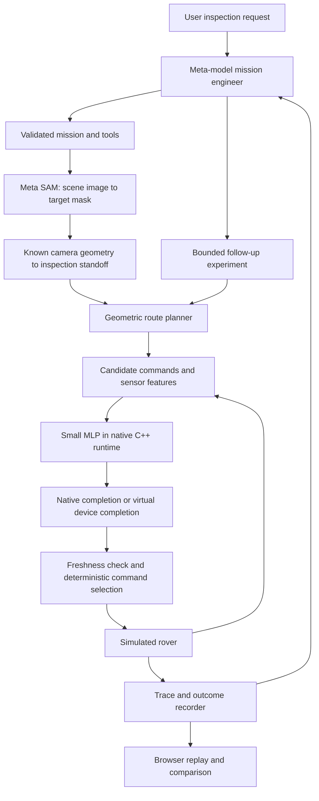

# RoverEdge — Vision-Guided Inspection Rover

**Status:** Design confirmed by the user; implementation approval is pending.
**Updated:** October 27, 2026.
**Track / theme:** Indie Developer / Push the Frontier.
**Development machine:** MacBook Pro M1 Pro. No physical robot required.

This document is the authoritative project proposal. The old pinned MatMul repository is no longer an implementation dependency. No feature, model quality, benchmark, or mission result is claimed as completed.

The October 27 design interview is recorded in [design-consensus.md](docs/design-consensus.md), with terminology in [GLOSSARY.md](GLOSSARY.md). The requirements below incorporate the accepted interview decisions; numerical defaults remain proposals until validated and frozen.

## 1. What we are building

**A software experimentation environment for robotics engineers that uses simulated inspection missions to show when computation delays affect rover behavior and investigate their causes. Meta vision grounds targets, a small local learned model scores driving commands, and an AI mission engineer investigates completed runs and tests bounded improvements.**

Example mission: **“Inspect the red storage container and return to the dock.”**

1. The mission engineer converts the request into a validated mission.
2. Meta SAM segments the requested target in an actual rendered scene image.
3. The application converts the target mask into an approach location using the simulator's known overhead camera geometry.
4. A geometric route planner supplies waypoints. A small collision-risk neural network scores candidate driving commands.
5. A native C++ runtime evaluates that network using freshly implemented matrix multiplication kernels.
6. The rover approaches, stops, records an inspection observation, and returns to its dock.
7. An experiment introduces explicitly modeled compute congestion. The interface shows prediction age, queue state, stops, collisions, and mission progress.
8. The mission engineer examines trace evidence, changes an allowed runtime setting, and requests a controlled rerun. The experiment runner determines whether it helped.

The central demonstration is a visible robotics mission with a measurable systems question: **When does faster or fresher inference actually improve robot behavior?**

The project does not depend on achieving a positive speedup. A result showing that queue policy matters more than kernel choice is useful; so is evidence that a tiny model runs best without threading.

### Confirmed decisions, recommendations, and assumptions

| Type | Statement |
| --- | --- |
| User decision | Build a robotics project for the Indie track and Push the Frontier theme. |
| User decision | Create a new public hackathon repository and implement the matrix kernels afresh during the event. |
| User decision | Preserve deterministic simulation, learned collision risk, C++ inference, four execution backends, and explicit device timing experiments. |
| Planning assumption requested by user | Meta, Baseten, and Modal credits are available for architecture planning. Account access and balances have not been tested here. |
| User constraint | Fireworks is optional; the project must work without it. |
| User decision | Combine visual mission grounding, local learned control, and one bounded experiment agent in varied inspection workflows. |
| User decision | Include photo-assisted scene drafting, direct scene editing, saved scenario versions, multi-target missions, and configurable controlled/exploratory comparisons. |
| Unverified assumption | SAM reliably segments the chosen synthetic target categories. The first implementation milestone must test this. |
| Planning constraint | Solo builder on M1 Pro; preserve the agreed scope and reserve November 3 for testing and demo preparation. Schedule feasibility remains unverified; surface gate failures without silently removing features. |

## 2. Where it is useful and why build it

| Field | Relevance |
| --- | --- |
| Robotics | Demonstrates perception-to-goal grounding, motion planning, collision avoidance, braking, inspection, and mission completion. |
| AI / machine learning | Uses a small trained collision-risk model, Meta segmentation, and an agent that works with experiment tools. |
| Edge inference | Studies stale observations, finite queues, memory admission, deadlines, and inference availability. |
| Hardware acceleration / numerical systems | Compares naive, blocked, parallel, and Apple Accelerate matrix execution on the actual inference shapes. |
| Robotics development tools | Provides a reproducible way to explore whether a runtime change improves a simulated mission before considering physical deployment. |

The original proposal already belonged to robotics and AI. This revision adds an understandable task, meaningful visual target selection, and evidence-driven experiment assistance around that core. The new value comes from connecting those parts, rather than attaching an unrelated chatbot.

The intended application is early-stage civilian inspection research, such as warehouse or facility navigation. This prototype is neither a validated physical robot controller nor a safety certification tool. Known pose, a known floor plan, and ideal range sensing deliberately simplify the problem.

## 3. Minimum complete scope

The submission needs varied mission families, a photo-assisted and directly editable scene workflow, one working target-perception path, one learned model, four native backends, one virtual device, one bounded agent, and a browser demonstration with visual before/after comparisons. A single complete mission is the first integration gate, not the full product boundary.

**Required:**

- One differential-drive rover in deterministic, flat warehouse scenes that remain static within each run.
- A known traversability map, known rover pose, and simulated range sensing.
- At least two visually distinguishable target categories for the initial SAM feasibility gate; report the categories actually validated.
- Single-target and multi-target inspection-and-return missions; open, narrow, and cluttered routes; missing, ambiguous, and unreachable target tests.
- Built-in scenarios, direct scene editing, photo-assisted rough scene drafting, and saved scenario versions.
- Actual SAM image input and returned mask used to select an inspection target.
- A geometric global route and a learned local command scorer.
- Fresh C++ matrix kernels plus an Accelerate comparison.
- Native M1 measurements and separately labeled modeled timing experiments.
- FIFO and latest-pending-observation queue policies.
- A mission engineer that can inspect traces and request a few validated reruns.
- Public source, reproducible results, and a three-minute demonstration.
- Exportable reports, configurations, metrics, and traces; visual comparisons tied to recorded run evidence.

**Deferred:** real robot hardware, ROS integration, MuJoCo or photorealistic 3D, SLAM, depth reconstruction, dynamic people, multiple rovers, multiple agents, GPU kernel development, persistent thread pools, temporal models, distributed training, ISA/RTL work, and analyst fine-tuning.

SAM is used for target grounding. Reconstructing a collision map from its masks is outside this slice. Inspection means approaching, stopping, and capturing an observation; automated defect diagnosis is not included.

## 4. Architecture



The agent operates before or between episodes. It never supplies wheel commands, changes the controller while an episode is running, or invents measurement results.

The simulator, numerical runtime, experiment runner, and UI have separate responsibilities. Start with a small application and ordinary modules, not a generalized robotics platform.

## 5. Technical stack and platform responsibilities

| Component | Proposed technology | Responsibility |
| --- | --- | --- |
| Simulation and experiments | Python, NumPy | Deterministic world, sensors, labels, scheduling, traces, evaluation |
| Model training | PyTorch on Modal | Train and export the small FP32 MLP |
| Native inference | C++20, CMake, pybind11 | Resident weights, reusable buffers, batched candidate inference |
| Matrix execution | New naive, blocked, parallel implementations; Apple Accelerate | Compare four backends on M1 Pro |
| Visual grounding | Meta Model API, SAM `sam-3.1` | Segment a requested target in a scene image |
| Mission / experiment agent | Muse Spark Open through Baseten | Parse missions, call constrained tools, analyze evidence, propose and test changes |
| Batch compute | Modal | Dataset generation and independent simulation jobs |
| Web backend | FastAPI on Modal | Mission orchestration, stored artifacts, demo API |
| Browser interface | TypeScript and Canvas | Rover animation, masks, queue view, charts, comparisons |
| Storage | Versioned local artifacts; Modal Volume when needed | Models, manifests, traces, results, recorded API responses |

The authenticated event guide identifies the Baseten hackathon model as **`meta-models/muse-spark-open-1026`**. Verify that endpoint with the issued account before building around it; generic Baseten examples use a different identifier.

Use one agent and one provider initially. If Baseten access fails, a tested Meta Model API reasoning model can replace that agent without changing the deterministic rover. Such a fallback must be labeled accurately and cannot be presented as demonstrated Baseten or open-weight usage.

Modal does not need a GPU for this small model unless measurement justifies it. Credits are resources, not a reason to add services.

Fireworks can later support a separately evaluated analyst experiment, including fine-tuning if suitable model access and training data exist. It is not a dependency, and fine-tuning is deferred until a baseline demonstrates a specific deficiency.

### Local versus hosted execution

Apple Accelerate and all claimed M1 Pro timings run on the local Mac. Modal's Linux machines cannot produce those measurements.

The hosted demo runs portable simulation and replays recorded M1 results. Each panel must distinguish a live hosted run, a recorded local run, and a modeled device run. No inbound connection to the user's laptop is necessary. Provide native benchmark reproduction commands for compatible computers; Apple Accelerate is available only on supported Apple systems. Compare all four backends on the same M1 Pro and show hosted measurements separately.

Pin tested package versions, compiler settings, model identifiers, and API configuration during setup. Do not invent version compatibility before the build is tested.

## 6. Robotics and perception contract

### Photo-assisted scenes and user configuration

Accept a photograph as a reference for a rough scene draft, show an editable top-down preview, and require confirmation of scale, obstacle footprints, dock, and targets before execution. Highlight uncertain geometry rather than treating inferred dimensions or hidden objects as measured facts. Automatic drafting is a feasibility gate, not a claim of accurate reconstruction from one photograph.

Users may instead select a built-in scenario or create a scene directly. Scene edits create saved versions. Mission target grounding uses a fresh rendered image of the confirmed simulation scene; the original photograph remains a reference. SAM's returned mask must determine the selected target rather than hidden object identifiers.

Expose validated rover dimensions and motion limits, sensor range, planning frequency, backend/worker settings, queue policy, freshness limits, and modeled device costs. Initially retain the differential-drive rover type and fixed model feature structure; mark configurations outside the training conditions. Changing a modeled device profile does not imply physical robot integration or validated performance on a particular board.

### World and mission

Use a top-down orthographic scene with known image-to-floor scale and static obstacle geometry. The camera image is supplied to SAM; its returned mask determines the target. The known map supplies traversability, not a hidden substitute for recognition.

Convert the mask boundary to floor coordinates, select a collision-free standoff, and plan a route to it. Never navigate to an object's occupied centroid. Use a concise target noun phrase for SAM. If there are no matches or ambiguity cannot be resolved, request clarification or report mission setup failure.

A successful mission requires reaching the standoff, facing the target, remaining stopped for the inspection dwell, saving the observation, and returning to the dock before timeout without collision. A rover that stops indefinitely is a failed or timed-out mission.

For multi-target missions, apply the inspection conditions to every required target before returning. Each observation includes target identity, rover pose, and completion status. Keep mission outcome separate from test verdict: a test expecting an unreachable-target response can pass even though the mission cannot complete. Automated defect diagnosis remains outside scope.

### Proposed defaults to freeze before data generation

These values are recommendations, not measured limits or previously approved requirements.

| Parameter | Initial proposal |
| --- | --- |
| Physics / planning periods | 5 ms / 50 ms |
| Rover footprint | Circle, 0.20 m radius |
| Maximum linear / angular speed | 0.60 m/s / 0.80 rad/s |
| Acceleration / braking magnitude | 0.80 / 1.20 m/s² |
| Angular acceleration magnitude | 1.60 rad/s² |
| Range sensor | 16 rays across 360°, 4 m maximum, no noise/dropout initially |
| Inspection center standoff | At least 0.50 m from target boundary |
| Waypoint tolerance / inspection heading tolerance | 0.15 m / 15° |
| Stopped condition | Linear speed ≤ 0.02 m/s and angular speed ≤ 0.05 rad/s |
| Inspection dwell | 1 simulated second |
| Mission timeout | 120 simulated seconds, excluding mission setup |

Also report total user-visible duration including API setup. Define dock tolerance, obstacle sizes, map bounds, and native pacing overrun limits at milestone 0.

Use A* over the known inflated map for global waypoints. The MLP is a local risk scorer, not a global planner.

Candidate commands `(linear m/s, angular rad/s)`:

```text
(0,0), (0.2,0), (0.4,0), (0.6,0),
(0.3,0.8), (0.3,-0.8), (0,0.8), (0,-0.8)
```

Among candidates below the validation-set risk threshold, prefer predicted kinematic progress toward the next waypoint; break ties by lower risk and then fixed candidate index. Use the same rule across backends. If none qualifies, or no fresh result exists, request braking subject to physical deceleration limits.

Collision detection must account for motion between physics samples. Braking is not instantaneous and cannot guarantee avoiding a collision once stopping distance is insufficient.

## 7. Learned model and fresh native runtime

### Model and data

Start with `24 → 64 → 32 → 1`, ReLU hidden activations and a sigmoid risk score.

| Features | Count |
| --- | --- |
| Range readings | 16 |
| Current linear/angular velocity | 2 |
| Next waypoint position in rover coordinates | 2 |
| Candidate linear/angular command | 2 |
| Previous linear/angular command | 2 |
| Total | 24 |

Generate labels by applying each candidate immediately for a one-second rollout with the declared dynamics and checking collision. This label is an immediate-action risk proxy; it does not predict the exact delayed closed-loop policy.

Include ordinary driving and difficult recovery states. Split map/episode families before sampling, fit normalization on training data, select thresholds using validation data, and freeze a held-out test manifest. Hidden geometry may label collisions but must not enter learned features.

The sigmoid is a risk score until calibration supports a probability interpretation. Sparse rays can miss hazards; record that sensing limitation.

### Native runtime

Write new kernels within the hackathon project:

- Naive FP32 matrix multiplication.
- Cache-blocked FP32 multiplication with correct tail handling.
- A simple parallel blocked variant with explicit worker configuration.
- Apple Accelerate `cblas_sgemm` as the system-library comparison.

Keep weights and intermediate buffers resident. Export weights in the required orientation once. Invoke the runtime once per eight-candidate batch. Release the Python GIL only while executing owned C++ work; avoid shared writable buffers between overlapping calls.

The model contains **3,713 parameters**, or **14,852 FP32 parameter bytes**. An eight-candidate evaluation involves approximately **57,856 matrix-multiplication FLOPs**, excluding bias and activation work. These are arithmetic counts, not latency estimates. This workload may be too small for parallel execution to help.

The model artifact records shapes, dtype, feature order, normalization, activation semantics, version, and hash. Reject malformed or nonfinite inputs and artifacts. Keep aggressive floating-point optimization disabled until parity is established.

## 8. Timing, queues, deadlines, and memory

Maintain three distinct evidence streams:

| Mode | Meaning |
| --- | --- |
| Native replay benchmark | Actual M1 execution on saved inputs; isolates numerical execution |
| Native closed loop | Actual asynchronous completion affects a wall-clock-paced simulation |
| Virtual closed loop | Deterministic completion events use declared modeled service durations |

In native closed loop, one background worker performs inference while the simulator continues advancing. Record pacing overruns; a simulation paused by inference is not a valid latency experiment.

In virtual mode, numerical computation may happen on the host, but its elapsed time never advances modeled time or gets added to the modeled duration.

### Initial virtual device

- One execution lane.
- Serial dispatch, input transfer, compute, and output transfer.
- Resident model weights.
- Capacity for two pending requests, separate from the executing request.
- FIFO rejects a new request when full.
- Latest-observation policy replaces pending work for the same rover; it does not cancel executing work.
- Memory accounting includes weights, reusable workspace, pending payloads, and in-flight payloads. This is a modeled allocation budget, not process RSS or cache simulation.
- Allocation rejection and memory release are explicit trace events.

Use a **20 ms reporting deadline** and a **100 ms hard observation-age limit** as initial proposed defaults. A deadline miss may still produce usable output before the freshness limit. Equality is accepted; exceeding a limit counts as a miss or expiry.

Check expiry before dispatch and at command consumption. Results identify episode, observation, request, candidate set, and model. An older result cannot overwrite a newer accepted result. A held command is usable only while its source observation remains fresh; otherwise brake.

For simultaneous virtual timestamps, process completion, observation/request creation, command consumption, then dispatch, before integrating the next interval. Freeze and test these semantics.

### Honest stress experiments

Use openly hypothetical service-duration profiles below, near, and above the 50 ms planning period. Show the assumed transfer and dispatch costs. The purpose is sensitivity analysis, not pretending the M1 needs those durations.

Include uncongested, steady-congestion, and brief burst-congestion conditions. Show observation age and a stage timeline for queue wait, dispatch, transfer, inference, and result consumption. Every duration has measured or modeled provenance; unavailable native stage measurements must not be invented.

A separate M1-calibrated profile may use measured backend-specific service tables. Identical hypothetical formulas for different backends cannot establish a kernel speedup. Neither profile validates a particular embedded board.

Freeze SAM responses and mission configuration for deterministic replays. Cloud model calls themselves are not claimed to be deterministic.

## 9. Bounded AI mission engineer

The same agent can prepare a mission and investigate completed episodes through a small tool interface:

| Tool | Allowed function |
| --- | --- |
| `locate_target` | Request SAM grounding for a validated target phrase |
| `run_episode` | Run an existing scenario under a validated configuration |
| `inspect_trace` | Retrieve actual events and outcome summaries |
| `get_latency_breakdown` | Read measured or modeled timing with provenance |
| `change_runtime_config` | Select an allowed backend or queue policy |
| `compare_runs` | Compare paired experiments and list changed settings |

Limit diagnosis to three follow-up runs per investigation. Validate every tool argument and impose API, execution, and time budgets.

When investigation is enabled, the agent may autonomously inspect a failed or degraded run and perform those bounded follow-ups. It answers: what happened, which evidence supports the explanation, what change was tested, and whether it helped. Show the last answer through a directly comparable before/after mission replay with metrics and configuration differences, including unchanged or worse outcomes. The software computes test verdicts; the agent explains them and reports when a cause is not established.

For a claimed improvement, hold map, seeds, model weights, risk threshold, controller, device profile, and timeout constant. Change one allowed runtime setting at a time. The agent cannot change the mission objective to make a failing result appear successful.

Users can configure new tests between runs. Controlled comparisons vary one selected factor; exploratory comparisons allow multiple changes and list all differences without attributing the outcome to one factor. This user flexibility does not expand the agent's bounded backend/queue authority. Freeze pass/fail expectations before each test batch.

Every explanation links to run IDs and trace events. “No improvement found” is valid. Compare the agent against a simple fixed queue-policy rule, and check recommendations on held-out scenarios. Useful tool-driven investigation is the agentic contribution; eloquent summaries alone are not evidence of usefulness.

## 10. Milestones and delivery gates

All milestones are currently **not implemented**. Dates are targets rather than a verified feasibility estimate. Preserve November 3 for testing and demo preparation and November 4 for final access checks and submission.

| Milestone | Target | Deliverable and acceptance gate |
| --- | --- | --- |
| 0. Scope and setup | Oct 27 | Explicit implementation approval; new repository; credentials smoke test; versions and experimental contracts fixed |
| 1. Visible robotics slice | Oct 27–28 | Real SAM mask selects target; geometric navigation completes approach, inspection, and return; absent/ambiguous target handled; photo-drafting feasibility checked |
| 2. Learned local control | Oct 28–29 | Seeded disjoint dataset, trained MLP, export agreement, validation quality report |
| 3. Native runtime | Oct 29–30 | Four backends pass layer/logit/score parity; saved-input timing and native closed-loop smoke test |
| 4. Device experiments | Oct 30–31 | Queue, expiry, transfer, and memory tests pass; reproducible congestion comparison |
| 5. Mission engineer | Nov 1 | Actual Baseten model uses tools, cites traces, and completes a bounded comparison |
| 6. Evaluation and hosted demo | Nov 2 | Full mission catalog, scene/photo editor, versioned scenarios, configurable comparisons, frozen held-out results, labeled artifacts, reports/exports, visual before/after replay |
| 7. Testing and demo preparation | Nov 3 | Final integration testing, three-minute video, public reproducibility instructions, contribution record, accessible artifacts |
| 8. Submission buffer | Nov 4 | Final access/rules check and submission before 9 PM Eastern |

The strongest early gate is milestone 1: verify actual SAM usefulness before investing in elaborate presentation. If synthetic recognition is unreliable, simplify self-created scene assets or target choices and retest; do not substitute ground-truth IDs while claiming perception.

If a gate slips, report the unfinished work and schedule implications. Do not silently remove agreed features, drop numerical correctness, or mislabel modeled timings. Fine-tuning remains post-MVP; the other explicitly deferred items remain future work.

## 11. Testing and evaluation

### Validation before final evaluation

Split scene/episode families into training, validation, and untouched final test sets before sampling. Train on the first group; use validation to choose model settings and the candidate-action risk cutoff and inspect both missed hazards and unnecessary stops. Separately propose minimum model and mission-quality requirements for explicit review, then freeze them, the model, and the evaluation protocol before final testing. A low collision count is insufficient if missions never finish.

The action-selection cutoff is distinct from an evaluation acceptance threshold. Do not tune on final test results or weaken requirements to rescue a failing result. Report final failures; a later tuned version needs a new untouched test set for a fresh independent assessment. Concrete quality requirements remain pending this review.

### Correctness gates

| Area | Required tests |
| --- | --- |
| Simulator | Replay determinism, ray geometry, braking distance, collision between samples, terminal states, impossible missions |
| Perception | Real image/mask response, target-position variation, absent target, ambiguity, valid standoff conversion |
| Dataset | Disjoint splits, training-only normalization, feature order, label rollout semantics |
| Kernels | Rectangular shapes, block tails, worker counts, reference multiplication |
| Inference | Layer outputs, logits, scores, malformed artifacts, nonfinite values, threshold/tie behavior |
| Scheduling | Zero load, queued load, overflow, replacement, expiry, simultaneous events, no host-time double counting |
| Memory | Exact admission boundary, rejection, release after completion/drop, bounded workspace |
| Agent | Invalid tool calls, exhausted budget, unsupported configuration, evidence citations, unchanged safety objective |
| Demo | Missing API access, replay fallback, readable timing labels, clean-start reproduction |
| Scene workflow | Photo preview/correction, geometry confirmation, direct editing, saved versions, fresh scene image after edits |
| Comparisons and reports | Frozen criteria, configuration differences, measured/modeled provenance, replay linked to results, reproducible exports |

Proposed numerical tolerance: `abs(error) ≤ 1e-5 + 1e-4 * abs(reference)`. Validate suitability before final benchmarking. Also report command disagreement; numerical tolerance alone does not prove identical decisions near thresholds.

Numerical correctness, deterministic simulation, scheduling semantics, and expected failure handling are mandatory gates before presenting performance claims.

### Experimental comparisons

1. Geometric reference controller and evaluation-only collision oracle establish baseline difficulty.
2. Learned controller with immediate output establishes a low-delay reference.
3. Saved-input replay compares all four backends on identical model inputs.
4. Native closed-loop trials measure actual M1 completion effects.
5. Virtual FIFO versus latest-pending compares freshness under fixed offered load.
6. A memory-budget sweep exposes admission failures.
7. Agent recommendations are checked against unchanged paired scenarios and held-out scenarios.

Start with 20 held-out scenarios per virtual condition and 1,000 warmed replay batches per backend across three interleaved repetitions. These are initial protocol proposals; document final sample counts and stopping rules before evaluation. Use a smaller explicitly reported repeated native subset if wall-clock time limits coverage.

Report mission completion, collisions, timeouts, inspection success, distance, completion time, stops, model recall/false negatives, queue wait, deadline misses, age at application, drops, and memory rejections. Include all scheduled decision opportunities in deadline accounting, with admitted/completed/dropped counts separately.

Record compiler flags, hardware, thread counts, warmup, machine state, artifact hashes, seeds, and timing boundaries. Use paired comparisons and uncertainty across episodes. Do not present a small sample as a reliable P99 estimate.

## 12. Results and conclusion

**No results exist yet.** Complete this table only from saved experiment artifacts.

| Question | Evidence required | Current result |
| --- | --- | --- |
| Does SAM ground the mission target? | Varied-scene target/standoff evaluation | Not measured |
| Is learned collision risk useful? | Held-out risk metrics and mission comparisons | Not measured |
| Which backend is fastest on M1? | Repeated saved-input benchmark | Not measured |
| Does native latency affect this mission? | Paced native closed-loop trials | Not measured |
| Does queue replacement improve freshness? | Paired virtual trials with fixed device assumptions | Not measured |
| Does fresher output improve outcomes? | Collision/completion results, including failures | Not measured |
| Does the agent add practical value? | Bounded tool runs, fixed-rule comparison, held-out checks | Not measured |

The final conclusion must state what improved, what did not, and the limits of simulation and sample size. Do not infer real-world robot safety from this prototype. Do not claim faster matrix multiplication caused better navigation without controlling numerical decisions and other runtime settings.

Publish a concise results report plus machine-readable traces and manifests. Keep native measurements, calibrated simulations, and hypothetical device experiments in separate tables.

Each export includes configurations, metrics, event traces, model identity, scenario version, hardware, backend settings, and timing provenance. Present numerical agreement, runtime performance, and mission behavior as connected views. A before/after display must reflect actual outcomes even when an attempted change did not help.

## 13. Demo plan

Present one civilian warehouse mission in a browser with:

- A large rover scene, requested target, SAM mask, route, and inspection marker.
- A compact queue and prediction-age display.
- A mission outcome panel.
- An agent panel showing actual tool calls and cited evidence.
- A comparison panel distinguishing measured M1 results from modeled behavior.
- Photo-assisted scene creation, direct editing, mission presets, and saved scenario selection.
- Directly comparable before/after mission playback connected to metrics and changed settings.

### Three-minute storyboard

| Time | Content |
| --- | --- |
| 0:00–0:20 | State the problem: a robot can act on an old AI decision even when its model is accurate. Enter the inspection request. |
| 0:20–0:55 | Show the real SAM mask becoming an approach location and the rover beginning the mission. |
| 0:55–1:25 | Show a declared modeled congestion case and its observed queue, prediction-age, and mission effects. |
| 1:25–2:10 | Show the mission engineer inspecting the trace, proposing one allowed change, and requesting a rerun. |
| 2:10–2:45 | Compare actual outcomes, then show the separate M1 backend table and held-out summary. |
| 2:45–3:00 | Identify event-built contributions, simulation limits, public code, and reproduction instructions. |

Adapt the narrative to actual findings. Never script a collision or improvement and present it as an experimental observation. Label recorded API responses, recorded runs, and accelerated playback. Keep a saved valid run available if a live cloud call fails.

## 14. Important project requirements

### Event eligibility and presentation

The authenticated participant guide was checked on October 27, 2026. It specifies public repositories, teams of at most four, event-built demonstrated functionality with identifiable contributions, rights to included materials, and a three-minute video. Its build window is October 27–November 4, with submission due November 4 at 9 PM Eastern. Recheck the guide before submission.

The rubric is Impact 30%, Meta tooling 25%, Technical execution 20%, and Demo 25%. RoverEdge addresses these through a concrete inspection mission, real visual grounding and tool use, controlled runtime experiments, and a visible comparison. These are design strengths, not guaranteed scores.

The proposed civilian robotics scope does not match the listed generic anti-project examples. Its value must remain the connected robotics experiment, rather than a standalone image analyzer. Final eligibility remains the organizers' determination.

Source: [authenticated event details](https://cerebralvalley.ai/e/meta-ai-developer-hackathon/details).

### Fresh MatMul implementation and contribution provenance

The implementation plan uses no source dependency on the previous MatMul repository. Write the new kernels during the permitted period in the new public project, and retain dated commits and a contribution record.

Making another repository private does not establish that work is new. Describe the actual new implementation accurately; if prior code or assets are incorporated after all, identify that reuse and verify the applicable rule rather than omitting it. Answer any organizer provenance questions truthfully.

Apple Accelerate, PyTorch, and other libraries remain third-party dependencies. Claim the event-built integration and custom kernels, not authorship of those libraries. This document does not change any repository visibility.

### Rights to code, datasets, and visual assets

Use self-created warehouse graphics and synthetic scenes or materials whose licenses permit the intended use and public distribution. Maintain a small source/license register. Keep API keys and private account details out of code, logs, screenshots, and public artifacts.

### Meaningful Meta contribution and provider verification

Demonstrate an actual SAM response affecting the mission and actual model tool use affecting experiment selection. Do not substitute mocked output in the final demo without labeling it.

Provider credentials, exact endpoint access, rate limits, and any open-weight prize qualification require verification. The event's open-weight bonus requires eligible model usage and partner verification; architecture alone does not establish eligibility.

### Accurate experimental claims

Clearly distinguish simulation from hardware, measured time from assumed time, model risk from guaranteed safety, and agent explanation from recorded evidence. Report failed runs and negative results.

The earlier conversation refers to “three other issues” without preserving their exact labels. This specification covers the identifiable concerns—asset rights, meaningful/verified model integration, and faithful demo/measurement claims—without inventing a missing earlier assessment.

## 15. Confirmation and implementation gates

1. Shared understanding of this consolidated scope is confirmed (Q48). Implementation authorization remains pending.
2. Resolve the final public repository location during setup; the user declines a development-hours estimate.
3. Smoke-test Meta SAM and the Baseten hackathon endpoint; confirm actual credits/access.
4. Select initial target categories and scene style using real segmentation tests; test the photo-drafting approach and geometry confirmation workflow.
5. Freeze world geometry, dynamics, mission success tolerances, and timing semantics.
6. After validation, review and freeze minimum held-out model recall, acceptable false-positive rate, and mission-quality gates before examining final test outcomes.
7. Freeze native pacing validity limits, sample counts, queue/memory profiles, and numerical tolerances.
8. Implement hosted portable simulation and labeled saved M1 results; select the exact live/recorded storyboard from actual findings.

Implementation remains paused until explicitly approved. Documentation preparation is not approval to build, deploy, change repository visibility, or submit.

## 16. References

- [Meta hackathon overview](https://dev.meta.ai/events/global-hackathon)
- [Authenticated rules, judging, deadlines, and partner details](https://cerebralvalley.ai/e/meta-ai-developer-hackathon/details)
- [Meta model catalog](https://dev.meta.ai/docs/models)
- [SAM API overview](https://dev.meta.ai/docs/sam/overview)
- [SAM segmentation guidance](https://dev.meta.ai/docs/sam/segmenting)
- [Baseten Chat Completions API](https://docs.baseten.co/reference/inference-api/chat-completions)
- [Baseten reasoning models](https://docs.baseten.co/inference/model-apis/reasoning)
- [Modal batch processing](https://modal.com/docs/guide/batch-processing)
- [Modal web endpoints](https://modal.com/docs/guide/webhooks)
- [Modal Volumes](https://modal.com/docs/guide/volumes)

The participant guide takes precedence over generic provider examples for hackathon-specific model identifiers and submission requirements. Model availability remains subject to an actual account-level smoke test.
